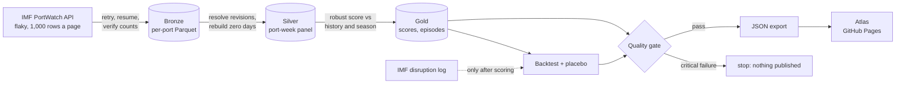

# Supply Shock Atlas

**Detecting global supply chain shocks from ship traffic.** A data pipeline scores 2,040 ports every week against their own history, then tests its alarms against the IMF's log of real disruptions. The result is an animated world map you can play from 2020 to today.

**▶ Live atlas:** https://sudhaseeli.github.io/supply-shock-atlas/

| | |
|---|---|
| **Data** | Daily port calls from satellite ship tracking (AIS), Jan 2019 – Oct 2026 · 3.07 M active port-days, 14.2 M port calls · [IMF PortWatch](https://portwatch.imf.org/) · NY Fed [Global Supply Chain Pressure Index](https://www.newyorkfed.org/research/policy/gscpi) |
| **Engineering** | Resumable ingestion from an unreliable API · bronze → silver → gold in DuckDB · incremental loads that handle source revisions · 16 data-quality checks that block publishing · pytest + GitHub Actions |
| **Analytics** | Robust anomaly detection · seasonality with lunar-calendar alignment · backtest with a placebo · before-and-after crisis analysis · single-port dependence |

## Key findings

- **Hormuz is the largest disruption the detector found.** Since March 2026, ports inside the Persian Gulf have handled 68% fewer ship calls than a year earlier (943 → 300 a week). Jebel Ali fell from 175 to 27 calls a week, and Kuwait fell 90%. Tracked transits through the strait fell 93.5%, from about 665 a week to 43, though ships that switch off their trackers wouldn't be counted.
- **Being outside the strait wasn't enough.** Fujairah, just beyond Hormuz, fell 54%, while Karachi rose 51% and Kandla 37%. The wider region gained only 5%, far too little to replace what the Gulf lost.
- **The Red Sea attacks show up as a redirection.** In the following year, Red Sea and Suez ports fell 12%, including King Abdullah Port (−69%) and Aqaba (−38%). On the route around Africa, Cape Town rose 34% and Las Palmas 17%. Transits show the same shift: Bab el-Mandeb −55%, Suez −45%, Cape of Good Hope +77%.
- **Some shocks don't show up at ports.** Ports in Panama changed only −6% during the canal drought while canal transits fell 27%, since a canal can restrict transits while ships keep calling. Baltimore fell 58% after the bridge collapse.
- **The detector beats chance by about 5×, but it misses short events.** It fired at 18% of 330 logged port-events, against 4% for the same ports a year earlier. The two-day 2024 US port strike triggered alarms at only 2 of 17 ports, because scoring is weekly.
- **Ship traffic and supply chain pressure are only loosely linked.** Correlation with the NY Fed index peaks at 0.19, too weak to use as a forecast.

Traffic shifting at the same time as a crisis doesn't prove that one caused the other. These figures are ship calls, not goods delivered.

## How the detector works



For each port and week:

1. **Baseline:** the median of up to the last 104 weeks, skipping the latest 2 so a shock can't hide itself. With only one year of history, a long blockade would start to look normal after about six months.
2. **Seasonal factor:** the port's usual ratio for that time of year, as a median across years so one crisis can't be learned as seasonal. Lunar New Year moves against the calendar, so East Asian ports align those weeks on the holiday itself. The first week of January gets its own key.
3. **Score:** the gap to expected on a `2·√calls` scale, which keeps noise roughly constant from a port with 5 calls a week to one with 500, divided by the port's own median absolute deviation.
4. **Alarm:** score ≤ −3 **and** at least 30% below expected. Ports under 3 calls a week aren't scored. Weeks with 2+ days of network-wide feed failure can't alarm.
5. **Episodes:** alarm weeks at a port merge when at most two weeks apart. Each episode is graded *In the IMF log*, *Nearby ports fell too* (2+ within 500 km), or *This port only*.

### Known limits

- **Short events are hard to see.** Scoring is weekly, so a two-day strike can vanish.
- **An alarm says traffic changed, not why.** 137 of 237 episodes lasting 4+ weeks have no logged event or falling neighbours. Nhava Sheva's 2025 fall and 2026 rebound is the largest; it could be a real disruption or a change in vessel tracking.
- **Seasonal factors use all years,** including later ones. That suits analysing the past, but a live system would need to use only earlier years.
- **Tracking can undercount.** Ship counts come from AIS, so vessels that switch off their transponders, which is more likely in a conflict, wouldn't be counted.
- **Chokepoint transits are optional.** The IMF's chokepoint feed can stay offline for hours, so the pipeline keeps working from port calls and flags the gap as a warning. The feed was available for the published data.

## Data engineering notes

The source API is the hard part. Services flip to `Invalid URL` or 504 for minutes at a time, one query shape can time out while another works, and each page holds only 1,000 rows.

- **Resilient:** requests keep polling through outages at a steady pace.
- **Verified:** each port's rows are checked against a count from the server before the file is kept.
- **Atomic and resumable:** a Parquet shard only appears once complete, so a re-run skips finished ports.
- **Incremental:** after the first load, runs fetch from 21 days before the watermark, because the IMF revises recent days. Silver keeps the newest copy of each port-day.
- **Efficient:** only days with traffic are requested. Silver rebuilds the zero days into a complete weekly panel.

## Quality gate

Critical failures exit with code 1 and nothing is exported.

| Check | Severity |
|---|---|
| Port-days present, one row per port-day, one row per chokepoint-day | critical |
| Calls reconcile from bronze to silver, and from days to weeks | critical |
| Vessel types sum to the total, no negative values | critical |
| Every port exists in the reference table | critical |
| Complete weekly panel, no missing calendar days | critical |
| Gold reconciles to the scores | critical |
| Logged event-ports exist in the reference table | warn |
| Alarm rate plausible (0.2–8% of port-weeks) | warn |
| Data under 21 days old, few feed outages, chokepoint feed present | warn |

The latest run passed all 16.

## Run it

```bash
git clone https://github.com/sudhaseeli/supply-shock-atlas && cd supply-shock-atlas
python -m venv .venv && source .venv/bin/activate     # Windows: .venv\Scripts\activate
pip install -e ".[dev]"

atlas run                              # download → build → quality gate → export
atlas build                            # rebuild from data already downloaded
python -m http.server -d docs 8000     # open http://localhost:8000
```

The first download can take a couple of hours because of the API's page size. Later runs only fetch recent weeks.

```bash
duckdb data/warehouse.duckdb "SELECT * FROM gold.episodes ORDER BY calls_lost DESC LIMIT 10"
```

## Tests

```bash
pytest -q
```

A synthetic world with known behaviour runs offline. The tests check that a blockade fires one correctly dated alarm, a steady port stays quiet, an annual shutdown is learned as seasonal, a network-wide dip counts as a feed outage, revised days replace older copies, the backtest credits the logged event, recovery time is correct, the quality gate catches corruption, and a short download is rejected. CI runs them on Python 3.10, 3.12 and 3.13.

## Project layout

```text
atlas/
  config.py      source URLs, paths, ingestion settings
  ingest.py      bronze: resilient, verified, resumable downloads
  transform.py   silver tables and the anomaly scoring
  analysis.py    backtest, recovery, crises, evidence, exposure, NY Fed link
  quality.py     16-check data-quality gate
  export.py      gold → docs/data/atlas.json
  cli.py         atlas run | ingest | build | export
docs/            atlas page (GitHub Pages) + exported data
tests/           synthetic fixture + pipeline tests
```

## License

MIT for the code. Sources: UN Global Platform; IMF PortWatch (portwatch.imf.org); Federal Reserve Bank of New York.
